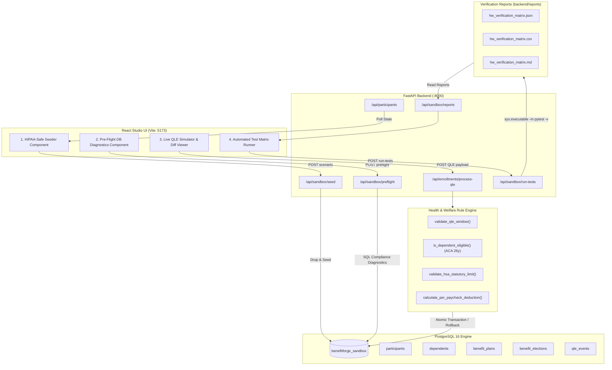

# BenefitForge — Application Flow & Architecture Architecture (`flow.md`)

---

## 1. End-to-End Application Lifecycle

### Phase 1: Test Data Setup (HIPAA-Safe Cohort Seeding)
1. **Trigger**: User selects a scenario tag in the UI (`all`, `open_enrollment`, `qle_life_events`, `dependent_age_out`) or calls `python scripts/seed_hw_data.py --scenario all`.
2. **Execution**:
   - `Base.metadata.drop_all(bind=engine)` and `Base.metadata.create_all(bind=engine)` reset sandbox state deterministically.
   - Fixed benefit plans seeded: `MED-HDHP-2026` ($130.00/mo base EE, HSA-eligible) and `MED-PPO-2026` ($216.67/mo base EE, non-HSA).
   - Fixed HIPAA-safe participant cohorts with realistic dates and relations seeded:
     - `EMP-1001` (Ananya Sharma, Active FT, Spouse + Newborn Child for BIRTH QLE).
     - `EMP-1002` (Vikram Patel, Part-Time, medical election blocked).
     - `EMP-2001` (Meera Krishnan, Active FT, Marriage QLE).
     - `EMP-3001` (Rajesh Verma, Active FT, Child Age 26 aged-out + Child Age 22 eligible).
3. **Response**: JSON confirmation with counts of seeded participants, dependents, and active elections. Frontend automatically refreshes the participant registry table.

---

### Phase 2: Environment Setup (Pre-Flight SQL Compliance Diagnostics)
1. **Trigger**: User clicks "Run DB Diagnostics" in UI or calls `python scripts/preflight_hw_check.py`.
2. **Diagnostic Pipeline**:
   - **PostgreSQL Connectivity**: Evaluates round-trip ping latency via `SELECT 1;`.
   - **Relational Schema Presence**: Asserts all 5 tables exist (`participants`, `dependents`, `benefit_plans`, `benefit_elections`, `qle_events`).
   - **Foreign-Key Referential Integrity**: Asserts cascade rules and foreign keys on `benefit_elections` linking to `participants` and `benefit_plans`.
   - **ACID CheckConstraint Verification**: Executes an isolated transaction with `SAVEPOINT` testing that negative annual salary / deductions are blocked by DB constraint `chk_participant_salary_positive`.
   - **Zero Overlapping Active Medical Elections**: Verifies that no participant has `> 1` active election simultaneously.
3. **Output**: Diagnostic result table rendered in UI with pass/fail badges, diagnostic latency, and compliance details.

---

### Phase 3: Interactive QLE Simulation & Atomic DB State Diff
1. **Trigger**: User configures a Qualifying Life Event in Section 3 of the UI and clicks "Execute QLE & Assert Atomic DB Mutation".
2. **Validation Pipeline (`/api/enrollments/process-qle`)**:
   - **Locking**: Row-level locking via SQLAlchemy `.with_for_update()` on `Participant` and `BenefitElection` to prevent race conditions.
   - **Pre-State Capture**: Current coverage tier, paycheck deduction, HSA contribution, and status recorded into `before_state`.
   - **Employment Status Rule**: Verifies `participant.employment_status == "ACTIVE_FT"`. Rejects `PART_TIME` with HTTP 400.
   - **QLE 30-Day Window**: Evaluates `(submitted_date - event_date).days`. Rejects if `< 0` (future event) or `> 30` (statutory window expired). Bypasses for `OPEN_ENROLLMENT`.
   - **Dependent Age-Out Boundary (ACA 26y)**: For every selected dependent, calculates exact age on `event_date`. Rejects dependents with relationship `CHILD` whose age is `>= 26` unless `is_disabled == True`.
   - **HSA Statutory Cap**: Enforces plan eligibility (`hsa_eligible == True`) and contribution caps ($4,300 for `EE_ONLY`, $8,550 for family tiers `EE_SPOUSE`, `EE_CHILD`, `EE_FAMILY`).
   - **Payroll Proration Math**: Calculates per-paycheck deduction using `(base_monthly_ee * tier_multiplier * 12) / 26` rounded half-up to two decimal places.
3. **Commit or Rollback**:
   - If any validation fails, an HTTP 400 is raised, triggering `db.rollback()`. No DB mutations persist. Error banner displays the rollback reason.
   - If all validations pass, updates or inserts `BenefitElection`, records audit row in `qle_events` with status `APPROVED`, and runs `db.commit()`.
4. **Diff Render**: UI renders side-by-side Before/After state cards highlighting changed fields and updated payroll deductions.

---

### Phase 4: Automated Test Execution & Result Matrix Generation
1. **Trigger**: User clicks "Run Full Pytest Suite" in UI, executes `pytest -v` via CLI, or pushes to GitHub CI.
2. **Hook Execution (`conftest.py`)**:
   - `reset_hw_sandbox` fixture seeds DB before test execution.
   - `pytest_runtest_makereport` hook captures requirement ID, persona, test suite, test name, pass/fail status, duration in ms, and error detail.
   - `pytest_sessionfinish` compiles all recorded records and outputs 3 audit-ready files into `backend/reports/`:
     - `hw_verification_matrix.json` (Structured JSON array for automated CI ingest).
     - `hw_verification_matrix.csv` (Spreadsheet-ready CSV export).
     - `hw_verification_matrix.md` (Markdown summary table with Total/Passed counters).
3. **UI Display & Export**:
   - Result table rendered with requirement IDs, personas, suite tags, and latency.
   - Direct download buttons for `.md`, `.csv`, and `.json` formats.
